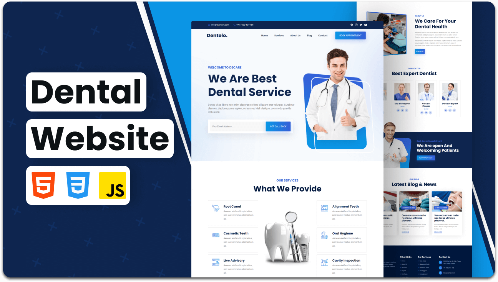

<div align="center">

  <h1>EverWell Clinic 🏥</h1>
  <p><strong>Modern, Fully Responsive Dental & Healthcare Clinic Website</strong></p>

  <p>
    
    
    
    
  </p>

</div>

---

## 📋 Overview

**EverWell Clinic** is a modern, responsive website tailored for dental practices and healthcare clinics. Built with clean semantic HTML5, modern CSS3, and lightweight vanilla JavaScript, the site provides an inviting, accessible patient experience across desktop, tablet, and mobile devices.

Visitors can explore dental services, learn about the clinic and its team of expert dentists, read recent health articles, request a quick call back, and find direct clinic contact details including primary and alternative phone numbers and email addresses.

---

## 📸 Website Preview



---

## ✨ Features

- **Responsive & Mobile-First Design**: Smooth, fluid layouts optimized for all viewport sizes (mobiles, tablets, and wide desktop screens).
- **Interactive Navigation & Sticky Header**: 
  - Dynamic sticky header that responds on scroll.
  - Mobile slide-out drawer menu with smooth toggle controls.
- **Top Bar with Alternative Contact Details**: Quick access in the top header to primary email, primary phone, and alternative/emergency contact lines.
- **Hero Callout & Call-Back Form**: Clean hero banner with quick lead capture form for patient call-backs.
- **Service Highlights**: Dedicated showcases for key treatments:
  - Root Canal Therapy
  - Teeth Alignment & Orthodontics
  - Cosmetic Dentistry & Whitening
  - Oral Hygiene & Preventive Care
  - Live Advisory & Consultations
  - Cavity Inspection & Diagnostics
- **About Us Section**: Informative overview of clinic history, hygiene standards, and care philosophy.
- **Doctor & Specialist Showcase**: Profile cards for expert dental surgeons with horizontal touch scroll and social profiles.
- **Appointment CTA**: Prominent Call-to-Action section guiding patients to book consultations.
- **Health & Dental Blog**: Recent medical and oral care news articles with publication dates and read-more links.
- **Detailed Footer**:
  - Operating hours & emergency schedule.
  - Quick navigation and service links.
  - Complete contact info with primary and alternative phone lines and email addresses.
  - Clinic physical address.
- **Back to Top Button**: Smooth scrolling return-to-top floating button.

---

## 📞 Clinic Contact & Location Information

| Detail | Information |
| :--- | :--- |
| **Clinic Name** | EverWell Clinic |
| **Physical Address** | 1247 Health Park Way, Suite 300, Medical District, NY 10001 |
| **Primary Phone** | [+1 (555) 234-8900](tel:+15552348900) |
| **Alternative / Emergency Phone** | [+1 (555) 234-8901](tel:+15552348901) |
| **Primary Email** | [info@everwellclinic.com](mailto:info@everwellclinic.com) |
| **Alternative / Support Email** | [support@everwellclinic.com](mailto:support@everwellclinic.com) |
| **Operating Hours** | Monday – Saturday: 9:00 AM – 10:00 PM |
| **Emergency Services** | 24/7 On-Call Support via Alternative Hotline |

---

## 🛠️ Technology Stack

- **Markup**: [HTML5](https://developer.mozilla.org/en-US/docs/Web/HTML) — Semantic elements, ARIA labels for accessibility, and modern SEO meta tags.
- **Styles**: [CSS3](https://developer.mozilla.org/en-US/docs/Web/CSS) — CSS Custom Properties (variables), Flexbox, CSS Grid, media queries, smooth animations, and clamp-based typography.
- **Scripting**: [JavaScript (ES6+)](https://developer.mozilla.org/en-US/docs/Web/JavaScript) — Vanilla JavaScript for DOM manipulation, navbar toggling, and scroll listeners.
- **Icons**: [Ionicons (v5.5.2)](https://ionic.io/ionicons) — High-quality SVG vector icon set.
- **Typography**: [Google Fonts](https://fonts.google.com/) — *Poppins* (Headings & Logo) and *Roboto* (Body copy).

---

## 📁 Project Structure

```text
EverWell-Clinic/
│
├── index.html                 # Main website homepage
├── index.txt                  # Content draft & textual reference
├── README.md                  # Project documentation & setup guide
├── style-guide.md             # Design tokens, color palette, and typography
├── favicon.svg                # Clinic favicon icon
│
├── assets/
│   ├── css/
│   │   └── style.css          # Main stylesheet with CSS custom properties
│   ├── js/
│   │   └── script.js          # Interactive JavaScript (navbar, sticky header, scroll)
│   └── images/                # Site images, banners, icons, and doctor portraits
│       ├── about-banner.png
│       ├── blog-1.jpg
│       ├── blog-2.jpg
│       ├── blog-3.jpg
│       ├── cta-banner.png
│       ├── doctor-1.png ... doctor-4.png
│       ├── hero-banner.png
│       ├── hero-bg.png
│       ├── service-banner.png
│       └── service-icon-1.png ... service-icon-6.png
│
└── readme-images/
    └── desktop.png            # Screenshot preview for documentation
```

---

## 🚀 Getting Started

No build tools or package managers are required. You can run EverWell Clinic directly in any modern web browser.

### Option 1: Open Directly

Simply double-click `index.html` or right-click and select **Open with** -> your favorite browser (Chrome, Edge, Firefox, Safari).

### Option 2: Run with VS Code Live Server

1. Open the `EverWell-Clinic` folder in **Visual Studio Code**.
2. Install the **Live Server** extension by *Ritwick Dey*.
3. Right-click `index.html` and click **"Open with Live Server"**.
4. The site will launch automatically at `http://127.0.0.1:5500`.

### Option 3: Run with Python

If you have Python installed:

```bash
# Python 3
python -m http.server 3000
```

Open `http://localhost:3000` in your web browser.

### Option 4: Run with Node.js

```bash
npx serve .
```

---

## 🎨 Customization

### Changing Contact Details
All contact details (addresses, emails, phone numbers) are located in:
- **Top Bar**: `index.html` inside `<div class="header-top">`
- **Footer**: `index.html` inside `<footer class="footer" id="contact">`

### Changing Theme Colors
Color variables are declared in [`assets/css/style.css`](./assets/css/style.css) under the `:root` selector:

```css
:root {
  --carolina-blue: hsl(201, 92%, 47%);
  --royal-blue-light: hsl(225, 68%, 53%);
  --oxford-blue-1: hsl(218, 70%, 18%);
  --oxford-blue-2: hsl(217, 100%, 12%);
  --oxford-blue-3: hsl(218, 71%, 11%);
  --gradient: linear-gradient(90deg, var(--carolina-blue) 0%, var(--royal-blue-light) 100%);
}
```

---

## 🌐 Browser Compatibility

The website is verified to work across:
- Google Chrome (latest)
- Mozilla Firefox (latest)
- Microsoft Edge (latest)
- Apple Safari (latest)
- Mobile browsers (Chrome Android, Safari iOS, Samsung Internet)

---

## 📄 License

This project is open-source and free to use for personal and commercial purposes.
